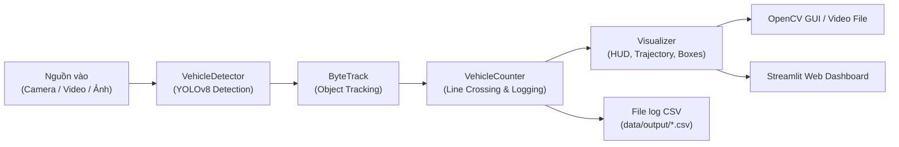

# ĐỒ ÁN MÔN HỌC: TRÍ TUỆ NHÂN TẠO (ARTIFICIAL INTELLIGENCE)
## ĐỀ TÀI: XÂY DỰNG HỆ THỐNG NHẬN DIỆN VÀ ĐẾM PHƯƠNG TIỆN GIAO THÔNG ĐƯỜNG BỘ


---

## 📌 Giới thiệu đề tài
Hệ thống giải quyết bài toán thị giác máy tính trong hệ thống giao thông thông minh (Intelligent Transportation Systems - ITS):
- **Phát hiện & Phân loại phương tiện (Vehicle Detection & Classification)**: Nhận diện chính xác 5 nhóm phương tiện đường bộ: **Ô tô con (Car)**, **Xe máy (Motorcycle)**, **Xe buýt (Bus)**, **Xe tải (Truck)**, **Xe đạp (Bicycle)**.
- **Theo dõi đối tượng (Object Tracking)**: Sử dụng giải thuật **ByteTrack** để duy trì định danh (ID) cho từng phương tiện qua chuỗi khung hình video.
- **Đếm xe tự động qua vạch kẻ ảo (Virtual Line Crossing)**: Thống kê lưu lượng phương tiện theo loại và hướng di chuyển mà không bị đếm lặp.
- **Giao diện Demo trực quan**:
  - Giao diện OpenCV thời gian thực (CLI / Webcam / Video).
  - Giao diện Web tương tác hiện đại bằng **Streamlit** phục vụ thuyết trình và chấm điểm đồ án.
- **Xuất dữ liệu thống kê (Data Logging)**: Tự động ghi nhận mốc thời gian (timestamp), ID xe, phân loại phương tiện và hướng di chuyển ra file CSV phục vụ phân tích báo cáo.

---

## 🏗️ Kiến trúc hệ thống (System Architecture)



---

## 📂 Cấu trúc thư mục dự án

```text
RoadDetectionAI/
├── data/
│   ├── samples/                # Thư mục chứa ảnh và video mẫu giao thông
│   └── output/                 # Thư mục lưu kết quả ảnh/video sau xử lý
├── models/
│   └── yolov8n.pt              # Trọng số mô hình YOLOv8 Nano (tự động tải)
├── src/
│   ├── __init__.py             # Khởi tạo package
│   ├── detector.py             # Lớp VehicleDetector: nạp model, lọc class phương tiện
│   ├── tracker.py              # Lớp VehicleCounter: theo dõi quỹ đạo, thuật toán cắt vạch & vùng ROI
│   └── visualizer.py           # Lớp Visualizer: vẽ HUD, Bounding box, vạch đếm, Heatmap, ROI
├── tests/
│   └── test_unit.py            # Bộ Unit Test (chạy nhanh không cần GPU)
├── app_streamlit.py            # Giao diện Web tương tác Dashboard Streamlit
├── main.py                     # File thực thi dòng lệnh / OpenCV Window
├── test_system.py              # Kịch bản kiểm thử tích hợp toàn diện hệ thống
├── requirements.txt            # Danh sách thư viện phụ thuộc
└── README.md                   # Tài liệu hướng dẫn & Đề cương báo cáo
```

---

## 🚀 Hướng dẫn cài đặt & Chạy chương trình

### 1. Kích hoạt môi trường ảo & Cài đặt thư viện
Mở Terminal trong PyCharm hoặc PowerShell tại thư mục dự án:
```powershell
# Kích hoạt môi trường ảo
.\.venv\Scripts\Activate.ps1

# Cài đặt các thư viện cần thiết
pip install -r requirements.txt
```

### 2. Chạy giao diện Web Streamlit (Khuyên dùng để thuyết trình)
```powershell
streamlit run app_streamlit.py
```

### PostgreSQL, lịch sử và phân quyền

Ứng dụng dùng PostgreSQL để lưu địa điểm, camera, phiên xử lý và sự kiện xe. Cài dependency rồi cấu hình `.streamlit/secrets.toml` từ file mẫu:

```powershell
pip install -r requirements.txt
Copy-Item .streamlit/secrets.toml.example .streamlit/secrets.toml
alembic upgrade head
streamlit run app_streamlit.py
```

`local_admin_username` và `local_admin_password` trong secrets là tài khoản quản trị nội bộ dùng cho lần đăng nhập đầu tiên. Mật khẩu được băm trước khi lưu vào PostgreSQL. Admin có thể tạo thêm user, địa điểm và camera trong sidebar; viewer chỉ được xử lý và tra cứu dữ liệu theo quyền ứng dụng. `DATABASE_URL` cũng có thể đặt bằng biến môi trường thay cho `database_url` trong secrets.

Các migration mới bổ sung trạng thái phiên, timestamp theo frame, chống trùng event và phân trang lịch sử. Sau khi cập nhật code, chạy:

```powershell
python -m alembic upgrade head
```

Tạo backup thủ công bằng PowerShell (lệnh sẽ hỏi mật khẩu PostgreSQL):

```powershell
.\scripts\backup_postgres.ps1
```

Khi chạy CLI, truyền `--camera-id` và `--location-id` để ghi event vào PostgreSQL; nếu không truyền hai tham số này, CLI vẫn chỉ xuất CSV cục bộ để tương thích các lệnh cũ:

```powershell
python main.py --source data/samples/traffic.mp4 --save --camera-id 1 --location-id 1
```
Trình duyệt sẽ tự động mở trang web dashboard tại địa chỉ `http://localhost:8501`. Tại đây bạn có thể:
- Kéo thả video hoặc chọn video mẫu có sẵn.
- Tùy chỉnh thanh trượt độ tin cậy (Confidence) và vị trí vạch đếm ảo.
- Xem biểu đồ thống kê lưu lượng xe thời gian thực.

### 3. Chạy bằng mã nguồn chính (OpenCV Window)

- **Nhận diện trên Webcam thời gian thực:**
  ```powershell
  python main.py --source 0
  ```
- **Nhận diện trên Video file:**
  ```powershell
  python main.py --source data/samples/traffic.mp4
  ```
- **Nhận diện trên Video và Lưu video + log CSV ra thư mục data/output/:**
  ```powershell
  python main.py --source data/samples/traffic.mp4 --save
  ```
- **Nhận diện trên Ảnh tĩnh:**
  ```powershell
  python main.py --source data/samples/traffic.jpg --save
  ```

### ⌨️ Các phím tắt khi chạy trên OpenCV:
- `q` hoặc `ESC`: Thoát chương trình.
- `p`: Tạm dừng (Pause) / Tiếp tục video.
- `h`: Bật / Tắt bản đồ nhiệt mật độ giao thông (**Heatmap**).
- `s`: Chụp ảnh màn hình (Snapshot) và lưu vào thư mục `data/output/`.
- `r`: Khởi tạo lại (Reset) bộ đếm xe về 0.

### 4. Kiểm thử phần mềm (Testing)
- **Chạy bộ Unit Test tự động (Không cần GPU, chạy < 0.2s):**
  ```powershell
  python -m unittest discover tests
  ```
- **Chạy kiểm thử tích hợp toàn hệ thống (End-to-End Smoke Test):**
  ```powershell
  python test_system.py
  ```

---

## 📊 Kết quả thực nghiệm & Benchmark mô hình (Model Performance)

Dữ liệu benchmark được trích xuất từ các lần huấn luyện thực tế trong `runs/detect/`:

| Thứ hạng | Mô hình | Kích thước | Epoch | Precision | Recall | mAP@50 | mAP@50-95 | Tốc độ / Thiết bị |
| :--- | :--- | :--- | :--- | :--- | :--- | :--- | :--- | :--- |
| **1 (Tốt nhất)** | **traffic_model-2 (YOLOv8n)** | 6.5 MB | 30 | **82.5%** | **82.3%** | **88.9%** | **68.4%** | ~45 FPS (CUDA GPU) |
| 2 | traffic_model_v2 (YOLOv8s) | 22.6 MB | 3 | 83.6% | 67.0% | 75.0% | 51.4% | ~25 FPS (CUDA GPU) |
| 3 | traffic_model (YOLOv8n) | 6.5 MB | 1 | 79.5% | 60.0% | 67.5% | 47.0% | ~45 FPS (CUDA GPU) |

> **Nhận xét chuyên môn cho đồ án:** Mô hình **YOLOv8n (traffic_model-2)** sau khi fine-tune 30 epochs đạt độ chính xác cân bằng cao nhất (**mAP@50 đạt 88.9%**), kích thước nhỏ gọn (6.5 MB) và tốc độ xử lý đáp ứng hoàn hảo yêu cầu thời gian thực (real-time) trên hệ thống camera giám sát thông minh.

---
- Link tải dataset mẫu: https://drive.google.com/drive/folders/1u2a9F1EqX_Y2ljNr-AsNs9XWLy5n0p1Z?hl=vi
